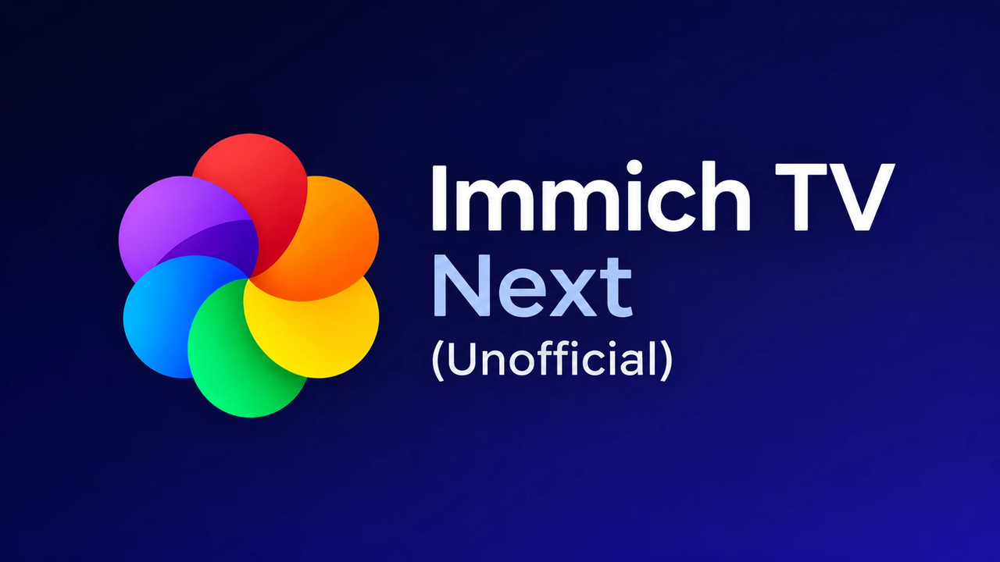
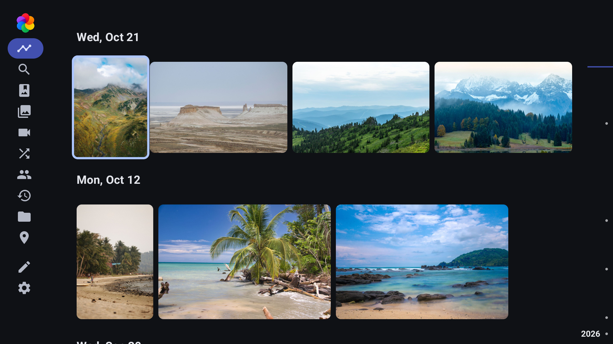
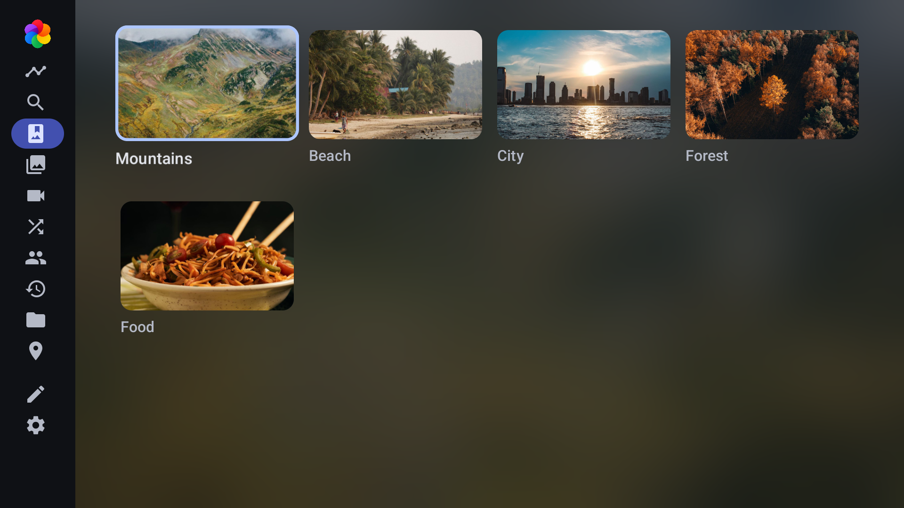
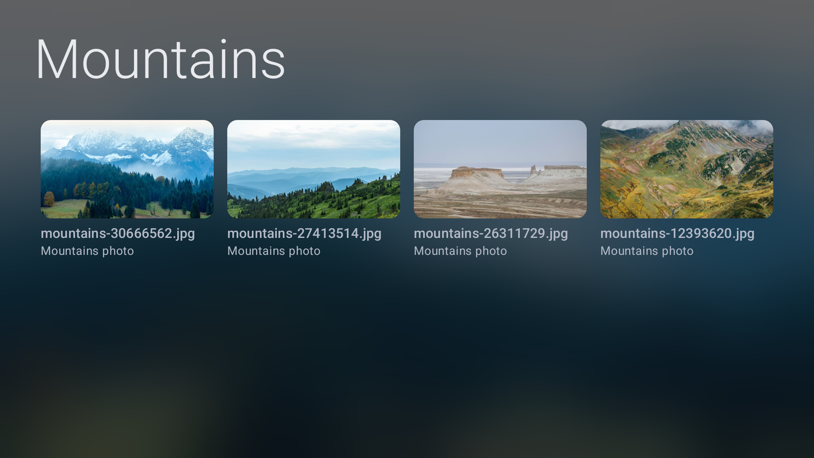
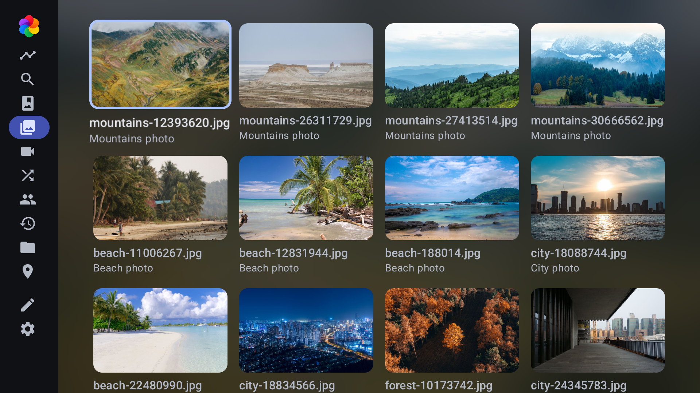
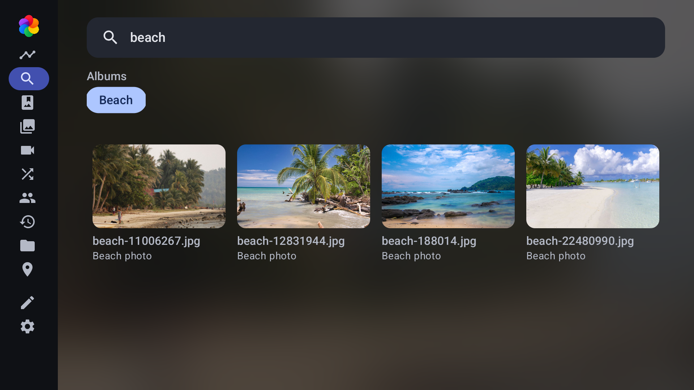
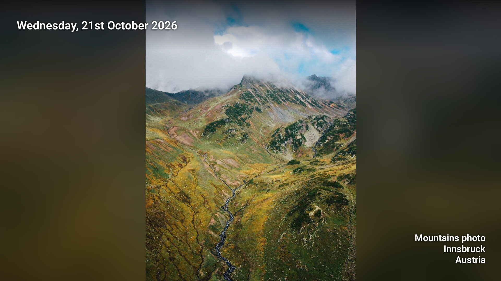
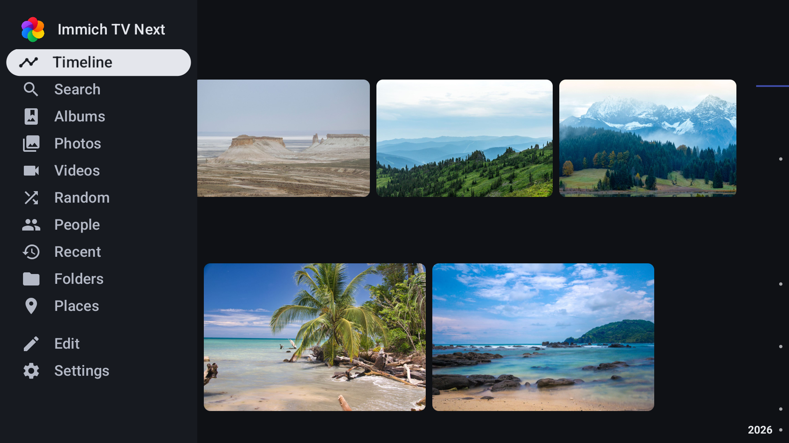
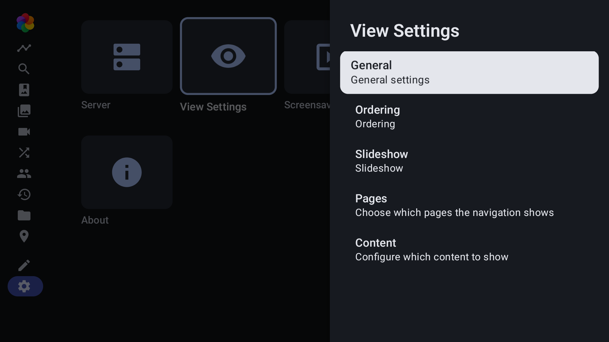
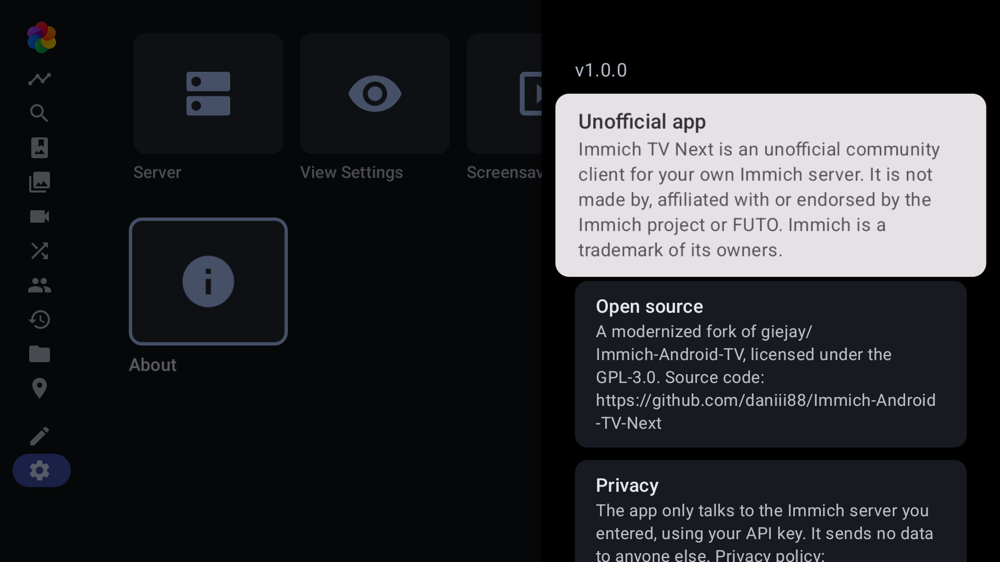

# Immich TV Next (Unofficial)

An Android TV client for your own [Immich](https://immich.app) photo server, built for the TV remote
with Compose for TV. It is a fork of [giejay/Immich-Android-TV](https://github.com/giejay/Immich-Android-TV)
(GPL-3.0) and keeps its functionality while the interface was rebuilt from scratch.

> **Unofficial.** This is a community project. It is not made by, affiliated with or endorsed by the
> Immich project. Immich is a trademark of its respective owners.

The app installs next to the original one (application id `io.github.daniii88.immichandroidtvnext`); settings
are not shared with it. It needs Android 7.0 (API 24) or newer and an Immich server **v3.0.0 or newer**.

## Screenshots

All screenshots were taken in the offline demo mode with its bundled stock photos
(see [credits](app/src/main/assets/demo/CREDITS.md)); no private photos are shown.

|                                                       |                                                      |                                                    |
|:-----------------------------------------------------:|:----------------------------------------------------:|:--------------------------------------------------:|
|       |            |   |
|         |            |          |
|  |     |              |

## Features

- Timeline with day headers, a mosaic layout, a quick scrubber, a memories row and a focus video preview
- Albums, all photos, videos, random, recent, seasonal, people, folders (drawn as folders with the cover photo inside and the number of assets), places, tags and the archive
- Search across your library (smart search, with a metadata fallback)
- Full-screen viewer with slideshow, video playback, favorites and a customizable photo overlay
- Screensaver (Daydream) with albums, favorites, random, recent or similar-time-period photos, an option for landscape photos only, portrait photos paired by person, place and day, and several transitions
- Home screen channels for quick access from the Android TV launcher
- Sign in with an API key (optionally with a proxy user and password for servers behind HTTP basic auth) or by scanning a QR code with your phone (the TV serves the form in your home network, no third party)
- Configurable home: show or hide the pages in the settings (seasonal, tags and the archive are off by default)
- Offline demo mode with sample photos: try the app without an Immich server (photo credits in [app/src/main/assets/demo](app/src/main/assets/demo/CREDITS.md))
- Complete D-pad navigation with a visible focus state; no touch screen needed

## What is different from the original

The original app is the base; this fork changes the following (and keeps the rest):

- **New interface.** Leanback is gone. The home is a Compose side navigation rail (icons collapsed, labels
  expanded) and the pages (albums, photos, people, ...) are Compose card grids. The timeline, the login, the
  settings dialogs, the metadata customizer and the whole slideshow/viewer (pager, overlays, controller bar)
  are Compose as well. The View based timeline remains as a compatibility switch (Settings, Debug).
- **Search page** (new): smart search with a metadata fallback and recent searches.
- **Screensaver transitions** (new): several transition styles for the screensaver and its in-app preview.
- **Performance:** a baseline profile and macrobenchmarks for startup and timeline scrolling.
- **Smaller and more private:** Firebase, Google Play Billing (donate) and play-services-auth were removed. The app
  has no analytics or tracking; see the [privacy policy](store/privacy-policy.md). The server URL, API key and
  settings are excluded from Android backups.
- **Own identity:** new name, application id, icon and banner, deep link scheme `immichandroidtvnext://`, so
  it can live next to the original app.
- **Store preparation:** privacy policy and listing texts in [store/](store).
- **Immich v3 compatibility** (album asset loading, search defaults, error format) is kept up to date.

The Kotlin packages and the Gradle namespace stay `nl.giejay.android.tv.immich` to keep merging from the original
simple. Many thanks to [giejay](https://github.com/giejay) and all contributors of the original project.

## Required API permissions

When you create the API key in Immich, grant these permissions:

- `activity.read`, `album.download`, `album.read`, `archive.read`
- `asset.download`, `asset.read`, `asset.view`
- `face.read`, `folder.read`, `library.read`, `memory.read`
- `partner.read`, `person.read`, `session.read`
- `tag.asset`, `tag.read`, `timeline.read`

## Build

Requires JDK 17 and the Android SDK.

1. Clone the project: `git clone https://github.com/daniii88/Immich-Android-TV-Next.git`
2. Copy `app/strings_other.xml.example` to `app/src/main/res/values/strings_other.xml` (a placeholder is enough; it is git-ignored and must not be committed).
3. Create `local.properties` with `sdk.dir=/path/to/Android/Sdk`.
4. Build the debug APK with `./gradlew assembleDebug` (output: `app/build/outputs/apk/debug/`). Run the tests with `./gradlew testDebugUnitTest`.

See [CLAUDE.md](CLAUDE.md) for the architecture and the working rules of this fork, and
[tools/test-server](tools/test-server) for a local Immich server with stock media.

## Support the project

Good bug reports help most: <https://github.com/daniii88/Immich-Android-TV-Next/issues/new/choose>. Even better
are pull requests: <https://github.com/daniii88/Immich-Android-TV-Next/pulls>.

If you find the app useful you can also support the original author (giejay, whose Immich-Android-TV this is forked from):

## FAQ

#### I'm not able to set the app as a screensaver

1. Enable developer mode on the device (click the build number or "Android TV OS Build" 7 times in
   System -> About).
2. Go to System -> Developer options and enable USB debugging.
3. If you do not have ADB installed on your PC, follow
   [these instructions](https://www.xda-developers.com/install-adb-windows-macos-linux/).
4. Connect to the device with its IP: `adb connect 192.168.xx.xx`.
5. On an Amazon Fire TV, first run `adb shell settings put secure amazon_ambient_enabled 0` and reboot.
6. Run `adb shell settings put secure screensaver_components io.github.daniii88.immichandroidtvnext/nl.giejay.android.tv.immich.screensaver.ScreenSaverService`
7. Done!

## License

GPL-3.0, see [LICENSE](LICENSE).
